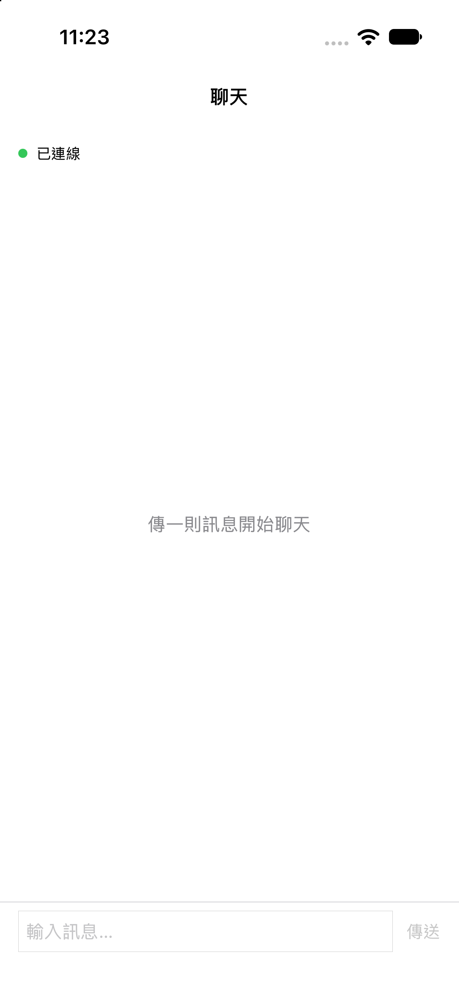
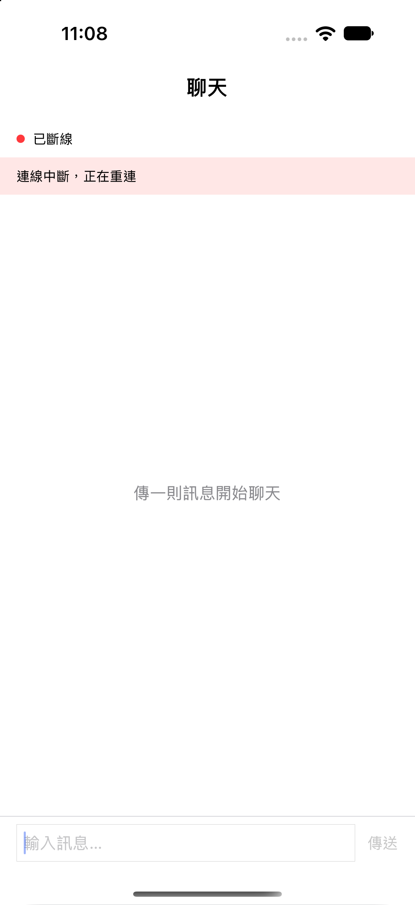
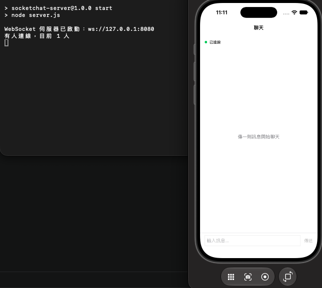
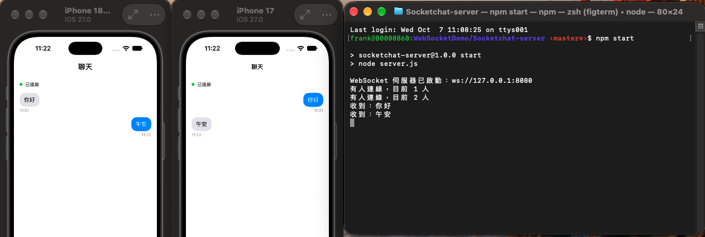

# SocketChat

一個使用 UIKit 開發的即時聊天練習，透過 WebSocket 在多台裝置之間互傳文字。自己的訊息靠右，其他人的訊息靠左。

## 專案簡介

SocketChat 用 `URLSessionWebSocketTask` 連到本機的 Node.js 轉發伺服器。畫面上顯示連線狀態、訊息列表與輸入列；伺服器把收到的文字轉給其他連線。

## 📸 應用程式截圖

<p align="center">
  
  
</p>

<p align="center">
  
</p>

<p align="center">
  
</p>

## 主要功能

- **即時收發**：連線後送出文字，其他裝置立刻收到
- **左右氣泡**：自己的訊息靠右、藍底；對方的訊息靠左、灰底，並顯示時間
- **連線狀態**：連線中、已連線、已斷線。斷線時顯示「正在重連」，約每 2 秒再試一次
- **多人同時在線**：兩台以上同時打開都能互看訊息。

## 專案架構

### 技術架構

- **UIKit + Storyboard**：聊天頁、狀態列、輸入列與兩種訊息 cell
- **URLSessionWebSocketTask**：連線、送出、接收、斷線重連
- **Node.js + ws**：本機轉發伺服器，聽 `ws://127.0.0.1:8080`

### 檔案結構

```
SocketChat/
├── ViewController.swift            # 聊天畫面、列表、傳送
├── ChatSocket.swift                # WebSocket 連線與收發
├── IncomingMessageCell.swift       # 對方的氣泡（靠左）
├── OutgoingMessageCell.swift       # 自己的氣泡（靠右）
├── Base.lproj/
│   ├── Main.storyboard             # 主畫面
│   └── LaunchScreen.storyboard
├── AppDelegate.swift
├── SceneDelegate.swift
└── Info.plist

Socketchat-server/                  
├── server.js                       # 把訊息轉給其他連線
└── package.json
```

## 使用流程

1. **啟動伺服器**  
   在 `Socketchat-server` 執行 `npm start`，看到 `ws://127.0.0.1:8080` 後保持終端機開著。

2. **打開 App**  
   用 Xcode 選模擬器按 Run。上方變成「已連線」後才能傳送。

3. **兩台一起測**  
   第二台模擬器再 Run 一次。回到第一台時直接點 App 圖示打開，不要再按 Run。任一邊送出的字會出現在另一邊左側。

4. **斷線**  
   關掉伺服器後，App 顯示「連線中斷，正在重連」。伺服器重新啟動後會自己連上。

模擬器與 Mac 共用網路，所以位址用 `127.0.0.1`。這組位址只適用於同一台電腦上的模擬器。

## 設計方式

畫面與連線分開：

- **ViewController**：管列表、輸入框、連線狀態與氣泡。自己送出的字先畫在右邊，再交給 `ChatSocket`。
- **ChatSocket**：管 `URLSessionWebSocketTask`。連上、送出、收下、斷線後重連。收到的字透過 `onMessage` 交回畫面。
- **伺服器**：收到一句話就轉給其他連線，不退回給發送者，避免同一句話出現兩次。

## 授權

此專案為個人練習，僅供學習展示用途。

---

👤 **作者**  
Created by kai
